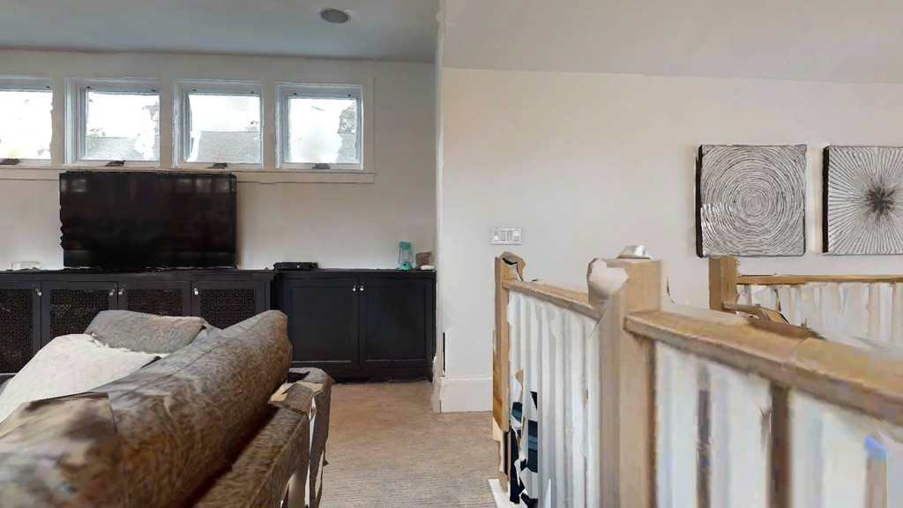
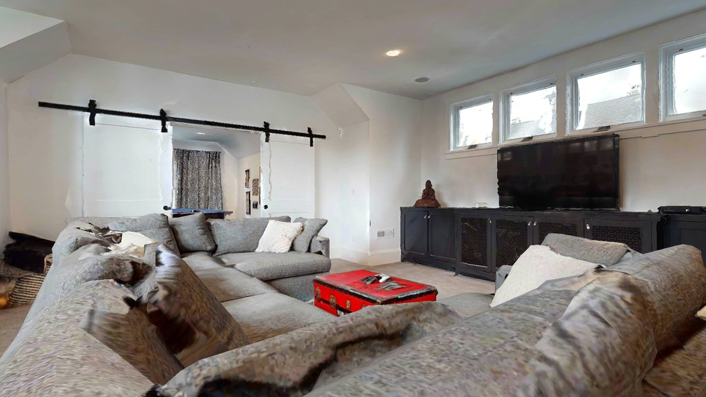
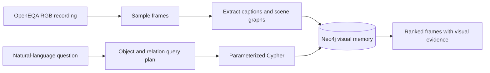

# Robot Visual Memory

**Robot Visual Memory turns recorded visual experience into searchable robot memory.** Built on **OpenEQA’s HM3D indoor exploration recordings**, it transforms images into a **graph** of objects, attributes, states, and spatial relationships in **Neo4j**, enabling explainable **image retrieval** from natural-language questions. Each result connects the question back to an observed frame, its caption, and the graph constraints that matched—making a robot’s past observations inspectable and useful.

## See it in action

**Example 3: “Is the upstairs TV on?”** from the [executed retrieval notebook](notebooks/02_graph_retrieval_local.ipynb):

```python
MY_QUESTIONS = ["Is the upstairs TV on?"]
my_results = gallery.ask(MY_QUESTIONS, k=2)
```

The local parser creates an object anchor `tv` with the requested state `on`. It does not encode “upstairs.” Below are the **top two frames from the saved notebook ranking**. Both scored **2.0** for **Object: tv**; neither matched the `on` state. Their scores tie, so frame ID determines their order.

| Rank 1 — score 2.0 | Rank 2 — score 2.0 |
|---|---|
|  |  |
| Frame `0a59b93e5b178772a02882b7ecccfba1` · sequence index 42 | Frame `0b7afe3defe2ff1e243a8bb43e5accc8` · sequence index 28 |
| Extracted TV state: `screen dark` | TV state: not reported |

*Images are copied directly from the saved Example 3 outputs. Imagery: OpenEQA / HM3D.*

The notebook pairs each image with its caption, objects, states, relationships, and matched constraints. These partial matches provide visual evidence for inspection; they do not establish the upstairs location or answer whether the TV is powered on.

## From observation to retrieval



1. **Cover the recording.** Split the ordered sequence into disjoint windows and retain one midpoint per window, with a maximum of 200 frames. Review the sampled video before extraction.
2. **Structure visual observations.** One VLM request per uncached frame produces a caption and a scene graph. Cached results survive reruns, and a three-frame preview makes extraction quality visible early.
3. **Build graph memory.** Store environments, frames, and object observations in Neo4j. Objects retain attributes and states; directed edges describe `left_of`, `above`, `near`, `on`, `inside`, and `in_front_of`.
4. **Interpret the question.** A local, rule-based Python parser resolves known synonyms and identifies labels, attributes, states, and relationships using the stored vocabulary. Query parsing makes no LLM calls.
5. **Retrieve evidence.** Python code constructs parameterized Cypher with our scoring rules. Neo4j executes the graph matches, calculates scores, and sorts frames from the selected episode, returning matched constraints and original images.

Objects are scoped to individual frames: seeing a chair twice creates two observations rather than assuming a shared physical identity. The graph therefore represents **what was observed**, with a traceable link back to the image.

The recorded pilot uses one **400-frame episode sampled to 200 frames**, containing **2,113 object observations** and **2,036 relationships**. It demonstrates graph retrieval without vector search or relevance benchmarking.

## Frame ranking

Frames receive a custom, application-defined graph-match score: **S = 2O + A + 3R**, where **O** counts matched object anchors, **A** counts matched attribute/state constraints, and **R** counts matched spatial relationships. Each query constraint contributes once. Attribute/state points require one object observation to satisfy all its anchor’s qualifiers; relationship points require connected objects satisfying their qualifiers in the same frame. Frames matching at least one anchor are ranked by descending score, with frame ID breaking ties. The score permits partial matches and is not an answer-confidence probability.

For **“white sofa near window”**, a frame containing a white sofa, a window, and their `near` relationship scores **8**: 2 for each object, 1 for white, and 3 for the relationship. A frame containing both objects and the white attribute without the matching relationship scores **5**; a white sofa alone scores **3**. More complete graph matches therefore rank higher, while partial evidence can still appear.

## Code to present

The key steps are marked with brief `# Presentation:` comments in the code.

| Part | Main implementation |
|---|---|
| Frame sampling | [`disjoint_window_sample`](src/rvm/episode_selection.py) |
| Caption and scene graph extraction | [`StructuredRunner` and `extract_frames`](src/rvm/extraction.py) |
| Frame-scoped Neo4j import | [`observation_id` and `ingest`](src/rvm/ingestion.py) |
| Question interpretation | [`RulesPlanner.plan`](src/rvm/planning.py) |
| Cypher construction and ranking | [`compile_plan` and `GraphRetriever`](src/rvm/retrieval.py) |

The [retrieval notebook](notebooks/02_graph_retrieval_local.ipynb) contains original episode questions and an editable **Ask your own questions** cell. Display and connection management live in a small [notebook helper](src/rvm/notebook.py), keeping the presentation cells short.

The [recorded Kaggle run](notebooks/01_prepare_openeqa_kaggle.ipynb) preserves the original outputs, including historical annotation and embedding stages. It is an execution record; use the [current graph preparation notebook](notebooks/01_prepare_graph_kaggle.ipynb) for new runs.

## Limitations

- **Extraction and sampling can miss evidence.** VLM labels and spatial edges can be incomplete or incorrect.
- **Language coverage is limited.** The rules parser can omit qualifiers such as “front” and “upstairs” and cannot reliably interpret activities, affordances, or negation.
- **Partial matches are allowed.** A returned frame or its score is not a generated answer or a calibrated confidence value.
- **No global spatial map.** There is no cross-frame object tracking, verified capture timing, camera pose, or 3D localization. Spatial directions are image-relative.

## Setup and execution

Requires **Python 3.11–3.13** and **Docker**. The commands below use Python 3.12.

```bash
git clone https://github.com/AlirezaAK2000/robot-visual-memory.git
cd robot-visual-memory
python3.12 -m venv .venv
source .venv/bin/activate
python -m pip install -r requirements-local.txt
python -m pip install --no-deps --no-build-isolation -e .
cp .env.example .env
```

Set `NEO4J_PASSWORD` in `.env` to at least eight characters. Graph retrieval uses the saved extractions and does not require an OpenAI API key. A key is needed only for new VLM extraction.

**Prepare the data.** Run [01_prepare_graph_kaggle.ipynb](notebooks/01_prepare_graph_kaggle.ipynb) on Kaggle with Internet enabled. It checks out the repository directly into `/kaggle/working`, inventories episodes, samples frames, and exports the graph bundle. Set the review/extraction flags only after inspecting the previews. No GPU is required.

Official question metadata comes from [OpenEQA](https://github.com/facebookresearch/open-eqa). The recorded RGB acquisition used a pinned [third-party episode mirror](https://huggingface.co/datasets/AIGeeksGroup/OpenEQA); byte identity with the unavailable original archive is unverified. Source revisions and acquisition provenance are retained in the bundle.

Download the graph export and unpack it as `data/robot-visual-memory-graph`. To reuse an older results-backup ZIP instead:

```bash
rvm prepare-graph /path/to/robot-visual-memory-results-backup.zip \
  --destination data/robot-visual-memory-graph
```

**Run retrieval locally:**

```bash
docker compose up -d --wait neo4j
rvm import data/robot-visual-memory-graph
jupyter lab notebooks/02_graph_retrieval_local.ipynb
```

Run the notebook cells in order, then edit `MY_QUESTIONS` and rerun the custom question cell. Neo4j Browser is available at [localhost:7474](http://localhost:7474). Startup is manual; stop the service while preserving its data with:

```bash
docker compose down
```

The original backup ZIP, full dataset, API caches, and `.env` stay outside Git. Only the saved notebook outputs and the README example image are included. Run offline software checks with `python -m pytest -q`; `python scripts/verify_notebooks.py` executes fresh synthetic copies without overwriting recorded outputs.
